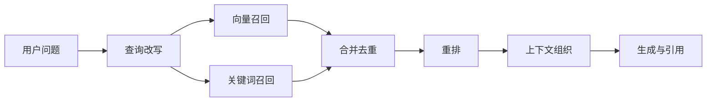

> [!NOTE] Demo 示例
> 这是一篇用于展示博客排版与搜索能力的示例文章，内容为通用的工程经验整理，
> 不包含真实论文成果、项目指标或生产数据。发布前请替换为你自己的笔记。

## 为什么“能跑”不等于“可用”

一个 RAG 原型通常在几天内就能跑通：读取文档、切块、向量化、召回、拼接上下文，再交给模型回答。
真正困难的是让它在一段时间内稳定地回答真实问题，并且让开发者能够解释“为什么这次答错了”。

我倾向于把 RAG 拆成四个可以分别观察的环节：

1. **摄取**：文档解析、去噪、切分与元数据。
2. **召回**：向量检索、关键词检索与混合排序。
3. **组织**：重排、去重、压缩与证据引用。
4. **生成**：提示词、上下文预算与拒答策略。

任何一个环节出问题，最终都会表现为“模型答得不好”，但修复方式完全不同。

## 切分策略应该服务于问题

固定长度切分会把一句完整的话切断，也会把标题和正文分离。一个更稳妥的做法是
**按语义边界切分，再为每个块补充上下文头**：

```python
from dataclasses import dataclass


@dataclass
class Chunk:
    text: str
    source: str
    heading: str


def with_context(chunk: Chunk) -> str:
    """把来源和章节标题带回块内，减少“断章取义”。"""
    return f"[{chunk.source} · {chunk.heading}]\n{chunk.text}"
```

块大小没有万能值。问答型任务通常需要更完整的段落，而事实查找型任务可以从更小的块开始。
先确定问题类型，再调参数，比反过来更有效。

## 混合检索与重排

纯向量检索擅长语义相近，但对专有名词、编号和精确短语不够敏感。把 BM25 类关键词检索
与向量检索合并，再做一次重排，往往比单独调大 top-k 更划算。



### 一个常被忽略的细节：证据要能被指回原文

如果最终答案无法定位到具体文档和段落，调试就会退化为“看日志猜”。在块级别保留稳定 ID，
在提示词里要求模型输出引用编号，并在前端提供跳转，能显著降低排查成本。

## 评测不要只看最终答案

可以分别记录：

- 召回阶段：目标证据是否出现在候选集中；
- 排序阶段：目标证据的排名是否靠前；
- 生成阶段：答案是否正确、是否引用了证据、是否出现无依据的扩写。

即使暂时没有标注数据，也可以先维护一小组“代表性失败案例”，每次改动后人工复核。
这比只看一个总体分数更能指导下一步。

## 结语

RAG 的工程质量来自大量小而明确的决定：如何切分、如何保留上下文、何时拒答、
如何让证据可追溯。先把这些环节做成可观察、可回滚的模块，再谈更复杂的优化。
