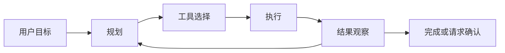

## 项目背景

AI Agent Lab 是一个个人实验空间，用来探索 **智能体、Tool Calling 与 AI Coding**。
它目前处于规划阶段，目标不是立即构建一个完整产品，而是把几个关键问题拆开验证。

> 当前状态：规划中。没有已发布的仓库、演示或评测结果。

## 想验证的问题

1. 工具数量增加时，模型的选择准确率如何变化？
2. 工具返回结构化错误，是否能减少无效重试？
3. 在代码修改任务中，如何设计可回滚的执行边界？
4. 哪些步骤需要人类确认，哪些可以自动执行？

## 初步架构

运行时需要明确：最大步数、最大耗时、连续失败上限，以及高风险操作的确认策略。

## 技术方向

- **Agent**：任务分解、状态管理与终止条件；
- **Tool Calling**：工具 schema、参数校验与错误协议；
- **AI Coding**：代码读取、修改、测试与回滚；
- **可观测性**：逐步记录输入、工具调用与结果。

## 技术难点

- 工具调用的参数错误往往比模型能力不足更常见；
- 多步执行中的中间状态难以复现；
- 自动修改代码需要严格的权限与回滚机制；
- 评测不应只看最终答案，还要看过程是否安全、可解释。

## 项目成果

目前只有规划与问题清单。**尚无实现、演示或实验数据。**

## 后续计划

- 先实现一个只有两三个工具的最小 Agent；
- 为每次运行建立完整轨迹记录；
- 设计一个小型但可重复的任务集；
- 在积累足够观察后，再决定是否扩展为多智能体系统。

## 链接

- 仓库地址：待补充
- 在线演示：待补充
