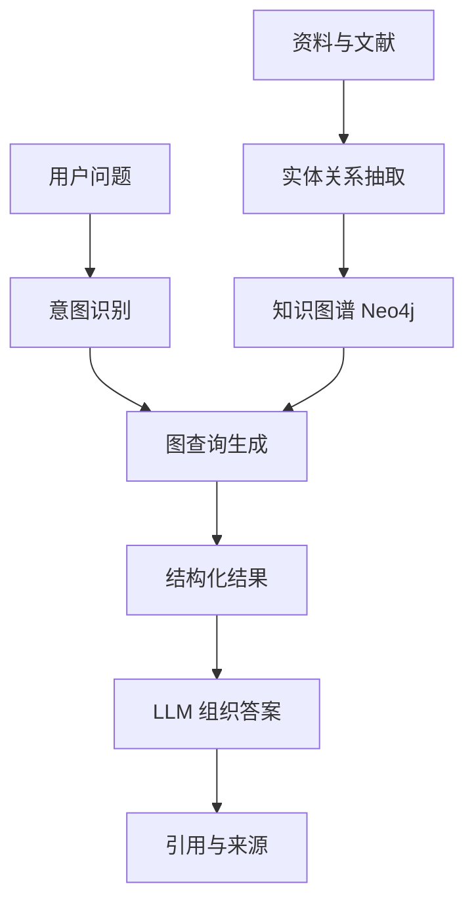

## 项目背景

传统建筑涉及类型、构件、年代、地域与工艺等多维知识，天然适合用知识图谱组织。
本项目探索将 **Knowledge Graph、Neo4j 与 RAG** 结合，构建可检索、可解释的传统建筑知识系统。

> 当前状态：探索与原型设计阶段。数据来源、图谱规模与上线地址待补充。

## 问题定义

- 将分散的建筑知识整理为实体与关系；
- 支持按类型、年代、地域等条件进行结构化查询；
- 在结构化检索之外，允许用户用自然语言提问；
- 让答案能够回到图谱节点或原始资料。

## 架构说明

## 技术实现

- **Neo4j**：存储建筑、构件、年代、地域与工艺等实体及关系；
- **Python**：数据清洗、图导入与查询服务；
- **LLM**：自然语言问题到图查询的转换，以及结果解释；
- **RAG**：在结构化图谱之外补充非结构化文献片段。

## 技术难点

- 领域实体边界不清晰，同一构件可能有多种称谓；
- 自然语言到 Cypher 的转换需要严格的模式约束；
- 图谱查询结果与文本证据需要统一引用方式；
- 资料来源的版权与准确性需要逐条核对。

## 项目成果

目前完成了领域建模与系统架构设计，**尚未公开数据集、图谱规模或问答准确率**。

## 后续计划

- 选取一个可管理的建筑类型作为最小领域；
- 建立实体、关系与属性的 schema；
- 实现图查询与 RAG 的混合检索；
- 增加来源引用与人工校验流程。

## 链接

- 仓库地址：待补充
- 在线演示：待补充
