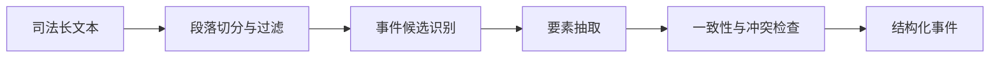

## 项目背景

司法领域的长文本通常包含大量事实、主体与时间关系，事件检测需要从复杂的叙述中识别
关键事件及其参与要素。本项目围绕 **NLP、知识蒸馏与长文本处理** 展开探索。

> 当前状态：研究探索中。数据、代码与实验结论均未公开，页面不展示未经核实的结果。

## 问题定义

从司法文书中抽取结构化事件信息，包括事件类型、触发词、参与者与时间等要素，
并在长文本与有限标注数据的约束下保持稳定表现。

## 架构说明

计划中的处理链路：

同时探索使用教师模型生成软标签，对学生模型进行知识蒸馏，以降低标注成本。

## 技术实现

- **Python**：数据处理与训练脚本；
- **PyTorch / Transformers**：事件检测与文本编码模型；
- **知识蒸馏**：教师—学生模型之间的软标签迁移；
- **长文本处理**：分段、聚合与跨段一致性检查。

## 技术难点

- 司法文本篇幅长、结构不统一，关键信息可能跨段分布；
- 事件边界与类型存在歧义，标注一致性难以保证；
- 蒸馏过程中，教师模型的错误可能被学生模型放大；
- 领域数据涉及隐私与合规，不能随意公开。

## 项目成果

目前处于问题建模与方法调研阶段。**尚未形成可报告的实验结果或论文成果。**

## 后续计划

- 明确事件 schema 与标注规范；
- 构建小规模、可人工复核的开发集；
- 比较长文本切分策略对事件抽取的影响；
- 在合规前提下整理可公开的方法说明。

## 链接

- 仓库地址：待补充
- 数据集：暂不公开
