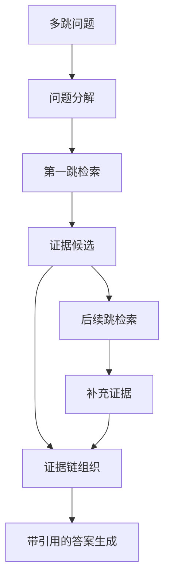

## 项目背景

Q-Restore 是一个面向**多跳问答（multi-hop QA）**的 RAG 研究原型。多跳问题往往需要跨越多段文档、
沿着推理链找到相互支撑的证据；仅靠一次向量召回，容易只拿到其中一跳的材料。

本项目的目标是探索：在检索与生成之间，如何更好地组织、追踪和恢复推理链上的证据。

> 当前状态：个人研究项目，持续迭代中。代码仓库、实验数据和论文信息待补充。

## 问题定义

给定一个问题与文档集合，系统需要：

1. 识别问题可能需要经过的推理步骤；
2. 为每一步召回候选证据；
3. 判断证据之间是否形成支撑关系；
4. 在生成答案时保留可回溯的引用。

## 架构说明

整体分为查询理解、分步检索、证据链组织与生成四个部分。具体实现仍在调整，
因此这里只描述结构，不声称已经达到某个性能水平。

## 技术实现

- **Python**：数据处理、检索流程与实验脚本；
- **PyTorch / Transformers**：需要微调或重排时使用的模型组件；
- **RAG**：检索增强生成的总体范式；
- 证据 ID 与引用编号贯穿检索、重排与生成，便于定位失败案例。

## 技术难点

- 多跳问题中，错误可能发生在任意一跳，最终答案错误不足以定位问题；
- 证据之间存在冗余、冲突或隐含依赖；
- 上下文预算有限，需要在“保留完整证据”和“控制长度”之间取舍；
- 评测需要同时关注答案正确性与证据可追溯性。

## 项目成果

目前完成了问题拆解、分步检索与证据链组织的基本流程原型。

**实验结果、论文发表与量化指标均待补充。** 在获得可复现的结果之前，本项目不会展示任何虚构数字。

## 后续计划

- 建立小规模、可人工复核的多跳问答评测集；
- 对比单次检索与分步检索的失败模式；
- 完善证据引用与前端可视化。

## 链接

- 仓库地址：待补充
- 在线演示：待补充
